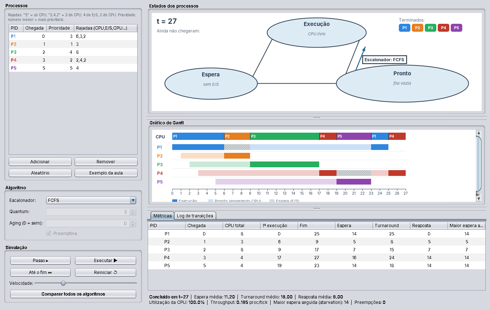
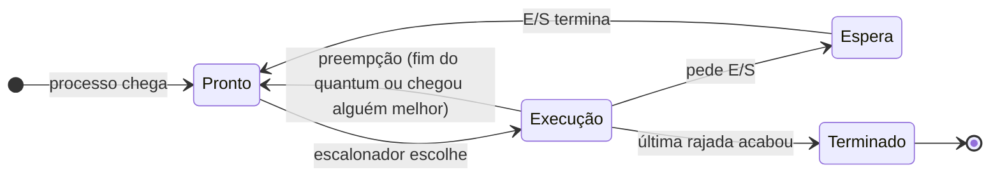
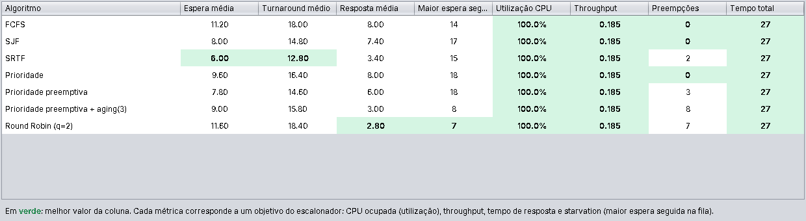

# Simulador de Escalonamento de Processos

Trabalho da disciplina de Sistemas Operacionais (FURB). Java 17+ e Swing, sem dependências externas.



## Sumário

- [Introdução](#introdução)
- [Como executar](#como-executar)
- [Conceitos: estados e objetivos](#conceitos-estados-e-objetivos)
- [Algoritmos implementados](#algoritmos-implementados)
- [Métricas](#métricas)
- [Arquitetura do código](#arquitetura-do-código)
- [Interface gráfica](#interface-gráfica)
- [Validação e resultados](#validação-e-resultados)
- [Conclusão](#conclusão)

## Introdução

Este trabalho é um simulador de escalonamento de processos, feito em Java com interface gráfica em Swing para a disciplina de Sistemas Operacionais. Ele mostra, passo a passo, como o sistema operacional decide qual processo usa a CPU a cada instante, e compara cinco algoritmos de escalonamento com as mesmas métricas.

O usuário cadastra um conjunto de processos, escolhe o algoritmo e acompanha a simulação: os processos mudam de estado no diagrama, o gráfico de Gantt cresce a cada unidade de tempo e, no fim, aparecem as métricas de desempenho. Um botão de comparação roda o mesmo conjunto em todos os algoritmos e destaca qual foi melhor em cada critério.

Escolhemos Java porque é a linguagem que o grupo mais domina, e Swing porque já vem com o JDK, sem nenhuma biblioteca externa. O programa roda em qualquer máquina com Java 17 ou mais novo.

## Como executar

- **Pelo .jar:** dois cliques em `SimuladorEscalonamento.jar`, ou `java -jar SimuladorEscalonamento.jar` no terminal (Java 17 ou mais novo).
- **Pelo código:** `compilar-e-rodar.bat` no Windows ou `./compilar-e-rodar.sh` no Linux/Mac.
- **Na IDE (IntelliJ, Eclipse, NetBeans):** marcar a pasta `src` como código-fonte e rodar a classe `simulador.gui.App`.
- **Testes do núcleo:** rodar a classe `simulador.TesteNucleo` (depois de compilar, `java -cp out simulador.TesteNucleo`).

## Conceitos: estados e objetivos

O simulador segue o modelo visto em aula, em que todo processo está sempre em um de três estados: **Pronto**, **Execução** ou **Espera**. Acrescentamos o estado **Terminado** para marcar os processos que já acabaram.

- **Pronto:** o processo tem tudo o que precisa e só espera a CPU. Pode haver vários processos prontos, organizados numa fila.
- **Execução:** o processo está usando a CPU. Como há uma única CPU, só um processo pode estar neste estado por vez.
- **Espera:** o processo pediu uma operação de entrada/saída (E/S) e não pode usar a CPU até ela terminar.



A transição *Pronto → Execução* é a única decisão do escalonador; as outras acontecem por eventos do próprio processo (pedir E/S, terminar) ou do sistema (fim do quantum, chegada de um processo mais prioritário).

O **escalonador** é quem decide qual processo da fila de prontos vai para a CPU. Segundo a aula, ele deve buscar quatro objetivos: manter a CPU ocupada, balancear a utilização do processador, maximizar o throughput com tempos de resposta razoáveis para usuários interativos, e tratar todos os processos igualmente, evitando o *starvation* (quando um processo fica esperando indefinidamente). Nenhum algoritmo atinge todos ao mesmo tempo, e o simulador serve justamente para mostrar essas trocas.

## Algoritmos implementados

O professor não exigiu algoritmos específicos, então escolhemos os cinco clássicos da literatura. Juntos, eles cobrem todos os objetivos do escalonador. Um algoritmo **preemptivo** pode tirar um processo da CPU antes de ele terminar a rajada; um **não preemptivo** deixa o processo rodar até terminar a rajada ou pedir E/S.

### FCFS (First-Come, First-Served)

O primeiro processo a chegar na fila é o primeiro a ser atendido, como uma fila de banco. É não preemptivo e o mais simples de todos. O problema é o *efeito comboio*: um processo longo na frente faz todos os curtos esperarem muito.

### SJF (Shortest Job First)

Escolhe o processo com a menor rajada de CPU. É não preemptivo: uma vez escolhido, o processo roda até o fim da rajada. Minimiza o tempo médio de espera, mas exige saber a duração das rajadas com antecedência, o que um sistema real só consegue estimar. Processos longos podem sofrer starvation se sempre chegarem processos curtos.

### SRTF (Shortest Remaining Time First)

É a versão preemptiva do SJF. Quando chega um processo com tempo restante menor que o do processo em execução, ele toma a CPU. Em caso de empate, o processo atual continua. Costuma dar o menor tempo médio de espera de todos, com o mesmo risco de starvation do SJF.

### Prioridade

Cada processo tem um número de prioridade, e o escalonador escolhe o mais prioritário (no simulador, **número menor = mais prioritário**). Pode ser preemptivo ou não. Sem cuidado, processos de baixa prioridade podem nunca rodar. Para isso implementamos o **aging** (envelhecimento): a cada N unidades de tempo na fila, o processo ganha um nível de prioridade, até eventualmente ser atendido.

### Round Robin

Cada processo roda por no máximo um **quantum** (fatia de tempo configurável). Se não terminar, volta para o fim da fila e o próximo assume. É preemptivo e trata todos igualmente, o que dá bons tempos de resposta para usuários interativos. Um quantum muito pequeno gera muitas trocas de contexto; um muito grande faz o algoritmo se comportar como o FCFS. Seguindo a convenção do Silberschatz, quem chega na fila entra antes do processo que acabou de perder a CPU.

## Métricas

Cada objetivo do escalonador visto em aula virou um número que o simulador calcula, para que os algoritmos possam ser comparados pelos mesmos critérios.

| Objetivo da aula | Métrica | Como é calculada |
| --- | --- | --- |
| Manter a CPU ocupada / balancear a utilização | Utilização da CPU (%) | tempo com a CPU ocupada ÷ tempo total |
| Maximizar o throughput | Throughput | processos concluídos ÷ tempo total |
| Tempo de resposta razoável | Tempo de resposta | 1ª execução − chegada |
| Evitar starvation | Maior espera seguida | maior trecho contínuo que um processo passou na fila de prontos |

Além dessas, o simulador mostra o **tempo de espera** (total de tempo na fila de prontos), o **turnaround** (fim − chegada, ou seja, o tempo total do processo no sistema) e o número de **preempções**. A tela mostra os valores de cada processo e as médias do conjunto.

## Arquitetura do código

O código separa o núcleo da simulação da interface gráfica. Assim, os algoritmos podem ser testados sem abrir a tela, e a tela só consulta o estado do simulador para desenhar.

```
src/simulador/
├── Estado.java              enum PRONTO, EXECUCAO, ESPERA, TERMINADO
├── Processo.java            dados do processo e tempos registrados
├── Escalonador.java         interface que todo algoritmo implementa
├── Simulador.java           relógio, filas de pronto e espera, E/S e histórico
├── Metricas.java            métricas calculadas no fim da simulação
├── TesteNucleo.java         testes contra exemplos do livro
├── algoritmos/
│   ├── FCFS.java
│   ├── SJF.java
│   ├── SRTF.java
│   ├── Prioridade.java
│   └── RoundRobin.java
└── gui/
    ├── App.java             ponto de entrada (main)
    ├── TelaPrincipal.java   janela principal e controles
    ├── PainelEstados.java   diagrama Pronto / Execução / Espera
    ├── PainelGantt.java     gráfico de Gantt
    ├── DialogoComparacao.java
    └── Cores.java
```

### Processos com E/S

Cada processo recebe uma lista de rajadas que alterna CPU e E/S, começando e terminando com CPU. Por exemplo, `3,4,2` significa 3 unidades de CPU, depois 4 de E/S (estado Espera), depois mais 2 de CPU. Um processo com só `5` usa a CPU por 5 unidades e termina.

### A interface Escalonador

Todo algoritmo implementa um único método, `escolher(prontos, atual, fatiaUsada, tempo)`. Ele recebe a fila de prontos e o processo em execução e devolve quem vai usar a CPU no próximo instante. Se devolver outro processo, o atual sofre preempção e volta para a fila. Com isso, trocar de algoritmo é só trocar de classe, e criar um algoritmo novo é só escrever uma classe nova e registrá-la em `TelaPrincipal.criarEscalonador()` e `comparar()`.

### O relógio do Simulador

O tempo é discreto: cada chamada de `passo()` avança uma unidade de tempo. Em cada passo, o simulador:

1. executa uma unidade do processo que está na CPU, avança as E/S em andamento e soma tempo de espera para quem está na fila;
2. se a rajada de CPU acabou, manda o processo para Espera (se ainda tiver E/S) ou para Terminado;
3. coloca na fila de prontos os processos que chegaram e os que terminaram a E/S;
4. pergunta ao escalonador quem roda no próximo instante.

Como a decisão do escalonador acontece no fim do passo, a tela sempre mostra o estado já decidido: nunca aparece a CPU livre com processos esperando na fila. Cada passo também guarda o estado de todos os processos, e esse histórico é o que vira o gráfico de Gantt.

## Interface gráfica

A janela tem os controles à esquerda e a visualização à direita, dividida em três áreas: diagrama de estados, gráfico de Gantt e métricas.

**Lado esquerdo (controles):**

- **Processos:** tabela editável com chegada, prioridade e rajadas de cada processo. Os botões permitem adicionar, remover, gerar processos aleatórios ou carregar um exemplo pronto.
- **Algoritmo:** escolha do escalonador. O quantum só fica ativo no Round Robin; aging e preempção só ficam ativos em Prioridade.
- **Simulação:** *Passo* avança uma unidade de tempo, *Executar* anima a simulação na velocidade escolhida, *Até o fim* mostra o resultado direto e *Reiniciar* volta ao instante zero.

**Lado direito (visualização):**

- **Estados dos processos:** reproduz o diagrama da aula, com as elipses Execução, Pronto e Espera e a seta do escalonador. Cada processo aparece como uma etiqueta colorida dentro do estado em que está, com o tempo restante da rajada. No topo ficam o relógio, os processos que ainda não chegaram e os que já terminaram.
- **Gráfico de Gantt:** a primeira linha mostra quem ocupou a CPU em cada instante. Abaixo, cada processo tem sua linha: cor forte quando está executando, cor clara quando está na fila de prontos e listrado cinza quando está em E/S.
- **Métricas e log:** tabela com os tempos de cada processo e, no fim, as médias. A aba de log lista todas as mudanças de estado com o instante em que aconteceram.

O botão **Comparar todos os algoritmos** roda o mesmo conjunto de processos em FCFS, SJF, SRTF, Prioridade (não preemptiva, preemptiva e com aging) e Round Robin, e mostra uma tabela com o melhor valor de cada métrica destacado em verde.



## Validação e resultados

Todos os algoritmos reproduzem os resultados dos exemplos resolvidos do livro *Fundamentos de Sistemas Operacionais* (Silberschatz). A classe `TesteNucleo` roda esses casos automaticamente:

| Caso de teste | Espera média esperada | Obtida |
| --- | --- | --- |
| FCFS, rajadas 24, 3, 3 | 17,00 | 17,00 |
| Round Robin (q=4), rajadas 24, 3, 3 | 5,67 | 5,67 |
| SJF, rajadas 6, 8, 7, 3 | 7,00 | 7,00 |
| SRTF, rajadas 8, 4, 9, 5 chegando em 0, 1, 2, 3 | 6,50 | 6,50 |
| Prioridade não preemptiva, 5 processos | 8,20 | 8,20 |

Um sexto teste confere a E/S: P1 com rajadas `3,4,2` e P2 com `5`, em FCFS, terminam em t=8 (P2) e t=10 (P1), como calculado à mão.

### Comparação no exemplo do simulador

O exemplo pronto da interface tem cinco processos, dois deles com E/S: P1 (chegada 0, prioridade 3, rajadas 6,3,2), P2 (1, 1, 3), P3 (2, 4, 8), P4 (3, 2, 2,4,2) e P5 (5, 5, 4). Rodando todos os algoritmos sobre ele:

| Algoritmo | Espera média | Turnaround médio | Resposta média | Maior espera seguida | Preempções |
| --- | --- | --- | --- | --- | --- |
| FCFS | 11,20 | 18,00 | 8,00 | 14 | 0 |
| SJF | 8,00 | 14,80 | 7,40 | 17 | 0 |
| SRTF | **6,00** | **12,80** | 3,40 | 15 | 2 |
| Prioridade não preemptiva | 9,60 | 16,40 | 8,00 | 18 | 0 |
| Prioridade preemptiva | 7,80 | 14,60 | 6,00 | 18 | 3 |
| Prioridade preemptiva + aging (3) | 9,00 | 15,80 | 3,00 | 8 | 8 |
| Round Robin (q=2) | 11,60 | 18,40 | **2,80** | **7** | 7 |

A utilização da CPU foi de 100% e o throughput de 0,185 processo por unidade de tempo em todos os casos, porque sempre havia algum processo pronto. Os resultados confirmam a teoria:

- **SRTF** teve a menor espera e o menor turnaround, como esperado de quem sempre atende o processo mais curto.
- **Round Robin** teve o melhor tempo de resposta e a menor espera seguida: é o mais justo e o melhor para usuários interativos, ao custo de mais trocas de contexto.
- **Prioridade** sem aging deixou um processo 18 unidades seguidas na fila. Com aging, esse pior caso caiu para 8, sinal de que o envelhecimento combate o starvation.
- **FCFS** foi o pior em espera, por causa do efeito comboio.

Um teste específico de starvation reforça o ponto: um processo de baixa prioridade competindo com 15 processos prioritários ficou 30 unidades seguidas na fila sem aging e 16 com aging.

## Conclusão

O simulador mostra na prática que não existe um algoritmo de escalonamento melhor em tudo. SRTF minimiza a espera, mas pode deixar processos longos esperando indefinidamente. Round Robin é o mais justo e responsivo, mas faz mais trocas de contexto. Prioridade atende bem os processos importantes, mas precisa de aging para não causar starvation. A escolha depende de qual objetivo o sistema quer priorizar, e a tela de comparação deixa essas trocas visíveis com números.
